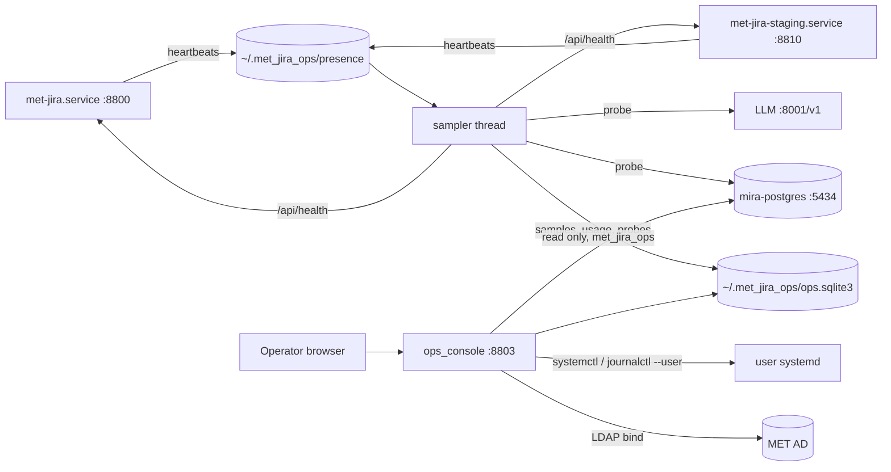

# ARCHITECTURE.md — MET Jira Ops

## Purpose

A read-only monitoring console for the MET Jira production and staging services. It shows service status, online users, usage, business counts, AI calls, request errors, and system load.

## Tech stack

- Python 3.10+ (host `/usr/bin/python3`), FastAPI, Uvicorn (1 worker), Jinja2 templates, static assets in `ops_console/static`.
- psycopg 3 for read-only PostgreSQL queries, ldap3 for AD login, `sqlite3` (WAL) for the ops-owned store.
- Runtime: user-level systemd unit `systemd/met-jira-ops.service` (installed by `scripts/install.sh`), port 8803. No container.
- Lint `ruff`, tests `pytest` (`tests/`).

## Components

| Module | Function |
| --- | --- |
| `main.py` | FastAPI app, pages, and JSON endpoints |
| `auth.py`, `ldap_auth.py` | Login: MET AD account in `METJIRA_OPS_USERS` or an enabled MET Jira system admin; MET Jira local admin as fallback. Cookie `metjira_ops_session`, 12 h |
| `sampler.py` | Background thread: online samples every 15 s, health probes every 60 s, daily pruning |
| `presence.py` | Reads MET Jira presence files |
| `pg.py`, `business.py`, `org.py` | Read-only queries on `met_jira` and `met_jira_staging` |
| `logs.py`, `system.py` | `journalctl --user` access and error logs, `systemctl --user` unit state, CPU, memory, disk |
| `store.py` | Ops-owned SQLite store |
| `config.py` | Settings from `configs/ops.env` and `METJIRA_OPS_*` variables |

## Data flow

1. MET Jira web services write presence heartbeats and events under `~/.met_jira_ops/presence`.
2. The sampler reads presence every 15 s and writes online samples and usage seconds to SQLite.
3. Every 60 s the sampler probes `http://127.0.0.1:<port>/api/health` of production and staging, the LLM endpoint, and PostgreSQL, and records the result (targets `web:production`, `web:staging`, `llm`, `postgres`).
4. Page requests query PostgreSQL (`met_jira_ops` role, read-only) and the SQLite store, and read `systemctl --user` and `journalctl --user` output.
5. Once a day the sampler deletes store rows older than 120 days.

## Persistent data paths

| Data | Host path | Setting |
| --- | --- | --- |
| Ops store (SQLite) | `~/.met_jira_ops/ops.sqlite3` (user lucas) | `METJIRA_OPS_STORE`, `METJIRA_OPS_HOME` |
| Presence files (written by MET Jira) | `~/.met_jira_ops/presence` | `METJIRA_PRESENCE_ROOT` |
| Config | `configs/ops.env` (git-ignored) | systemd `EnvironmentFile` |

No container and no bind mount. Schema and deviations are in `DATA_MODEL.md`.

## Build plan

1. Install dependencies (`fastapi`, `uvicorn`, `jinja2`, `python-multipart`, `psycopg`, `ldap3`; dev: `pytest`, `ruff`) for `/usr/bin/python3`.
2. Make sure MET Jira production and staging run and `mira-postgres` listens on `127.0.0.1:5434`.
3. Run `scripts/install.sh`: creates `configs/ops.env`, the `met_jira_ops` role and grants, and starts `met-jira-ops.service`.
4. Open `http://10.113.17.65:8803/` and sign in.
