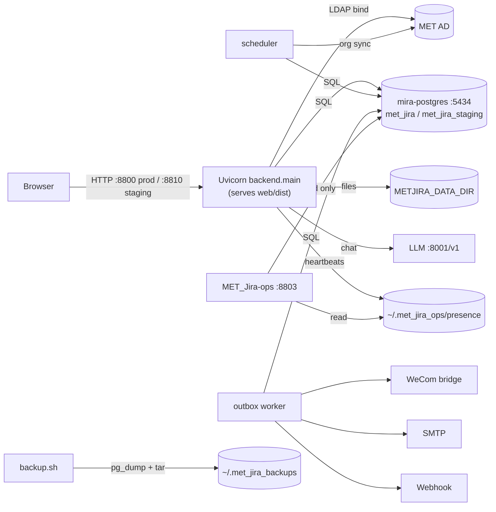

# Architecture

MET Jira is a FastAPI and SQLAlchemy backend with a React/TypeScript frontend. PostgreSQL
is the deployed data store; SQLite is used by isolated backend tests.

## Tech stack

- Backend: Python 3.10+ (host `/usr/bin/python3` 3.12), FastAPI, Uvicorn, SQLAlchemy 2,
  psycopg 3, Alembic (`backend/migrations/`), APScheduler 3, ldap3, httpx, openpyxl, Pillow,
  prometheus-client. Lint `ruff`, tests `pytest` (`tests/backend`).
- Frontend: React 19, Vite, TanStack Query, dnd-kit, TypeScript (`web/`). Tests `vitest`
  and Playwright (`web/e2e/`). The backend serves the build output `web/dist`.
- Database: PostgreSQL 16 with `pg_trgm`.
- Runtime: user-level systemd units (templates in `scripts/ops/systemd/`), no app container.
  On host 65, PostgreSQL runs in Docker (`mira-postgres`).
- External: MET AD over LDAP (`configs/ldap.env`), LLM at `METJIRA_LLM_BASE_URL`
  (`http://10.113.17.65:8001/v1`), WeCom push through the wecom-bridge
  (`METJIRA_WECOM_PUSH_URL`), SMTP mail (`METJIRA_SMTP_*`).

## Deployment on host 10.113.17.65

The repo has two worktrees. `README.md` describes host 63; host 65 differs as follows.

| Item | Production | Staging |
| --- | --- | --- |
| Worktree / branch | `/home/hal/docker/mira/MET_Jira` / `production` | `/home/hal/docker/mira/MET_Jira-staging` / `staging` |
| Web service | `met-jira.service`, Uvicorn on 0.0.0.0:8800 | `met-jira-staging.service`, Uvicorn direct on 0.0.0.0:8810 |
| Database | `met_jira` | `met_jira_staging` |
| Scheduler | on | off (`METJIRA_SCHEDULER=false`) |

- Both databases are in one PostgreSQL 16 cluster: container `mira-postgres`, compose
  project `mira`, `127.0.0.1:5434`. `compose.override.yaml` (git-ignored) sets this.
  `compose.yaml` alone gives `met-jira-postgres` on 5433, which is hub-postgres on 65.
- Staging on 65 has no Nginx / PgBouncer edge. The edge scripts in `scripts/ops/` target
  :8801 and :6433 and do not apply here.
- Whether `met-jira-scheduler`, `met-jira-outbox`, and the backup timers are installed on 65
  is unverified. On 2026-11-02 production `/api/health` reported `backup_age_hours` 169.6.

## Data flow

1. A user signs in with an AD account (LDAP bind) or a local admin account.
2. The browser loads the React app from the backend and calls `/api/*`.
3. The backend reads and writes PostgreSQL and stores uploads under `METJIRA_DATA_DIR`.
4. The agent and JQL assistant call the LLM. Live-data answers use authorized read tools.
5. The scheduler syncs the AD org chart, sends digests and reports, and refreshes PM risk
   events. It writes notifications to the outbox table.
6. The outbox worker delivers webhook, WeCom, and email messages.
7. The frontend sends presence heartbeats. The backend writes them under
   `METJIRA_PRESENCE_ROOT`, which the Ops console (`MET_Jira-ops`) reads.
8. Open project pages subscribe to `/api/live/stream?project=KEY` (SSE). Issue and
   project writes enqueue events after commit; other tabs invalidate issue/board
   queries without a manual refresh. Fan-out is in-process (single Uvicorn worker).

## Persistent data paths

| Data | Host path | Used by |
| --- | --- | --- |
| PostgreSQL cluster | Docker named volume `mira_mira-pg` (`/data/docker/volumes/mira_mira-pg/_data`) | `mira-postgres`, mounted at `/var/lib/postgresql/data` |
| Production files (attachments, avatars, covers, imports) | `/home/hal/docker/mira/MET_Jira/data` | `met-jira.service` (`METJIRA_DATA_DIR`) |
| Staging files | `~/.met_jira_staging` in the unit templates; `MET_Jira-staging/data` also exists (actual path on 65 unverified) | `met-jira-staging.service` |
| Presence heartbeats and events | `~/.met_jira_ops/presence/{production,staging}/` and `presence/events/YYYY-MM-DD.jsonl` (user lucas) | web services write, Ops reads |
| Backups | `~/.met_jira_backups` (`METJIRA_BACKUP_DIR`) | `scripts/ops/backup.sh` |

Details and known storage deviations are in `DATA_MODEL.md`.

## Build plan

1. Install Python dependencies (`pip install --user -e '.[dev]'`) and `web/` packages (`npm ci`).
2. Start PostgreSQL (`docker compose up -d` in the production worktree on 65).
3. Create `.env` from `.env.example` and `configs/ldap.env` from `configs/ldap.env.example`.
4. Run `python -m backend.ops bootstrap` (Alembic migrations, local admin).
5. Build the frontend (`npm run build` in `web/`).
6. Install and start the user systemd units (`scripts/ops/install-systemd.sh`; staging:
   `install-systemd.sh staging`). Check `/api/health`.
7. Develop on `staging`, verify, then merge into `production`.

## Hardware PM schedule control

Delivery projects (`settings.work_mode=delivery`, default) use this path. Ongoing projects
keep boards and issue mail but skip baseline publish, portfolio target ranking, and
project-level cascade alerts.

1. Delivery project settings define `plan_start_date` and `target_date`.
2. A project administrator publishes an immutable `ProjectScheduleBaseline` snapshot.
3. `schedule_cascade` builds the same-project `blocks` graph, isolates strongly connected
   cycle components, and propagates the latest predecessor constraint in workdays.
4. Analysis returns baseline/current/forecast dates, target impact, confidence,
   schedule urgency, evidence, and an `analysis_token`.
5. Apply recomputes the analysis and checks the token, baseline-derived suggestion, and
   issue lock version. Every item reports applied, skipped, or stale independently.
6. `ScheduleRiskEvent` deduplicates lifecycle state and records acknowledge, accept,
   reject, snooze, worsening, and resolution decisions.
7. The portfolio control tower ranks delivery projects by target impact and unresolved
   decisions. Timeline renders baseline, current, and forecast layers over the same date
   axis for delivery projects.
8. Issue details create directed blocking links as `source blocks target`; the link builder
   shows this direction before submission and can reverse it for “blocked by”.

Cross-project blocking links are reported as baseline-readiness errors because the schedule
engine intentionally propagates only inside one project goal.

## Agent

The agent uses deterministic intent routing before model invocation. Each intent receives a
small tool subset, navigation is server-gated, and live-data intents require a successful
read tool. Conversations and rolling summaries are server-owned. Durable global/project
memories require explicit user creation and can be deleted by that user.

Workflow editing has a separate draft path. The settings editor sends the unsaved canvas to
`/api/agent/workflow-draft`. Instruction mode asks the model for one draft and may propose new
statuses. If that draft still has structural errors after one retry, the same required repairs
used by optimize mode are applied before the preview is shown. Optimize mode diagnoses the
canvas from stable finding codes, status order, the type template and issue counts. A line that
still names a removed template status restores that status. A flow with no completion status
gains one and a path to it. Applying the preview creates those statuses immediately and leaves
transitions unsaved. Saving the workflow still requires the existing save action. A note on
the same screen explains the software-readiness field check. That check is not a workflow
status, and neither optimize nor instruction mode adds a status for it.

Entering 研发中 on an electrical requirement is a field gate. The scheme note must be
filled and confirmation requested. Electrical, process, and—when the requirement involves
software—the software owner must each confirm. The assistant cannot write those
confirmations or request them. A later edit of the note is compared by the configured
DeepSeek model. A material change, or a failed comparison, clears the confirmations.
Mail for the request, the change, the completed confirmation, and a withdrawal goes
through the same outbox as other issue mail.

Electrical requirements, bugs, and stories go from 研发中 to 开发完成 and then to the
test status. Tasks, sub-tasks, and epics do not use 开发完成. With no software, a person
who can move the issue may enter 开发完成 directly. When the issue involves software, the
stored Jira snapshot status must be exactly 待上机验证. That status also sets software ready
and adds watchers for directory users matched uniquely from the snapshot assignee and
tester names. A Chinese name matches the Chinese name synced from the directory
(`users.native_name`), and only when one enabled person has that name. When that
snapshot due date is later than the issue final due date, Mira emails the
issue assignee (or the reporter), the software owner, and the matched software
assignee once for that pair of dates. An early move stays in 研发中, stores `_software_test_wait`
on `issues.extra`, and tells the user that testing will start after software finishes.

Entering the project's test status is a field gate on the issue: a tester, verification
method and criteria when the form owns those fields, and, when the requirement involves
software, a software owner who has confirmed it is ready. The automatic handoff below
does not also require that checkbox. The chat assistant reports the missing fields
before it asks for confirmation, and it cannot tick software ready. Saving a
software Jira key, or using Refresh software Jira, reads that issue from the configured
relay (`GET /api/jira/relay?key=` with `X-Api-Key`). The snapshot keeps assignee, tester,
status and due date. A failed read stores the error and leaves the issue status and
software_ready unchanged. Excel import does not call the relay and does not set the
wait flag. Every five minutes the scheduler refreshes up to 20 distinct keys that belong
to issues still open, oldest snapshot first. One response is copied onto every open issue
that shares the key. If the relay cannot be reached, that round stops and the stored
snapshots stay. After the refresh, a waiting issue still in 研发中 whose snapshot status is now
待上机验证 moves to the test status and notifies the tester, once a tester and any
verification fields on the form are present.

Release notes live in `web/src/releaseNotes.ts` and stay in the notification menu, ordered by
the release date. Newer notifications appear above that note. Each browser opens the menu once
per release id. The notes describe changes that affect use, and mention bug fixes and interface
polish in a single line.

## Operations

The scheduler refreshes open software-Jira snapshots every 5 minutes and PM risk events every 15 minutes. Non-production environments default
to shadow mode, which computes and records risk state without sending notifications. Production
uses the outbox for idempotent webhook, WeCom, and email delivery.
