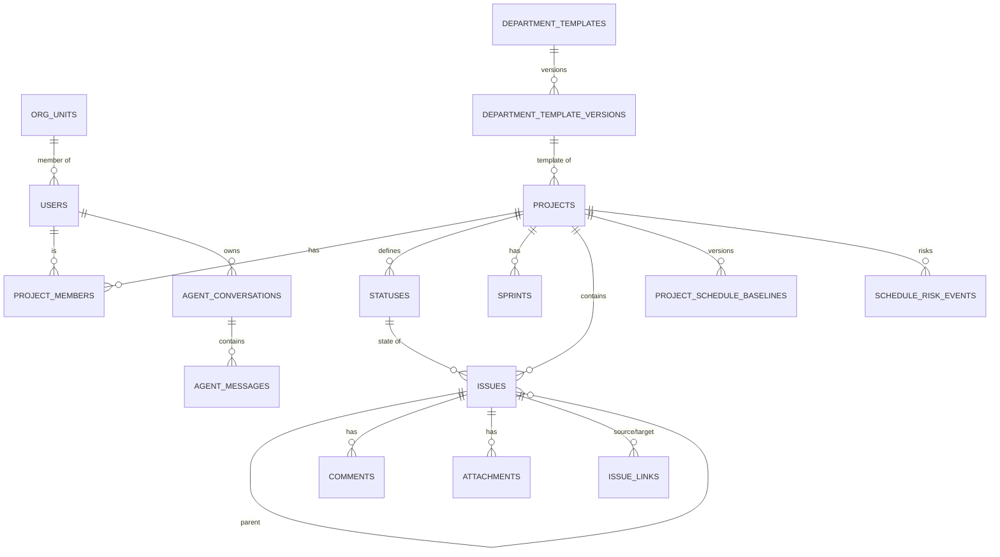

# Data Model

Persistent application data is stored in PostgreSQL. Runtime uploads and generated files use
the configured MET Jira data directory; persistent business data must not be written into the
source tree.

## Tables

SQLAlchemy models are in `backend/models/`. Migrations are in `backend/migrations/versions/`
(head `0032`). The table below lists every table and the tables it references by foreign key.
Read the model file for columns, types, and indexes.

| Model file | Table | Foreign keys to |
| --- | --- | --- |
| `org.py` | `org_units` | `org_units` (parent) |
| `org.py` | `users` | `org_units`, `users` |
| `org.py` | `org_sync_runs` | `users` |
| `project.py` | `projects` | `department_template_versions`, `users` |
| `project.py` | `project_members` | `projects`, `users` |
| `project.py` | `statuses`, `machine_groups`, `sprints`, `boards` | `projects` |
| `project.py` | `machines` | `machine_groups` |
| `issue.py` | `issues` | `issues` (parent), `projects`, `sprints`, `statuses`, `users` |
| `issue.py` | `issue_machines` | `issues`, `machines` |
| `collab.py` | `comments`, `attachments`, `issue_links`, `watchers`, `activity_logs`, `notifications` | `issues`, `users` |
| `collab.py` | `saved_filters` | `projects`, `saved_filters`, `users` |
| `collab.py` | `import_batches` | `projects`, `users` |
| `governance.py` | `approval_requests` | `issues`, `statuses`, `users` |
| `governance.py` | `master_assets` | none |
| `governance.py` | `project_assets` | `machines`, `master_assets`, `projects` |
| `template.py` | `department_templates` | none |
| `template.py` | `department_template_versions`, `department_template_audits` | `department_template_versions`, `department_templates`, `users` |
| `template.py` | `org_unit_template_recommendations` | `department_templates`, `org_units` |
| `template.py` | `project_template_migrations` | `department_template_versions`, `projects`, `users` |
| `schedule.py` | `project_schedule_baselines` | `projects`, `users` |
| `schedule.py` | `schedule_risk_events` | `issues`, `projects`, `users` |
| `agent.py` | `agent_conversations`, `agent_memories` | `projects`, `users` |
| `agent.py` | `agent_messages` | `agent_conversations` |
| `agent.py` | `agent_feedback` | `agent_messages`, `users` |
| `agent.py` | `agent_audits`, `agent_actions` | `users` |
| `agent.py` | `ai_reports` | `org_units`, `projects`, `users` |
| `outbox.py` | `outbox_events` | none |
| `concurrency.py` | `rate_limit_events`, `ai_slot_leases` | none |

## Boards

- `boards.columns` is a JSON list of `{name, status_ids, wip}`. A new project starts with one
  column per status, in status order, on both the kanban and the scrum board.
- Migration `0027` gives every existing status its own column. A status that only shared
  a column, such as 已驳回 inside 已完成, is moved into a new column. Adding a status does
  the same for that status only, and does not undo a grouping an admin saved afterwards.

## Scheme confirmation

Electrical requirements keep a scheme note and three confirmations before they can enter 研发中.

- `issues.scheme_note`: the scheme text. Electrical members, the issue assignee, and the software owner may edit it before confirmation is requested.
- `issues.electrical_scheme_ok`, `issues.process_scheme_ok`, `issues.software_scheme_ok`: tri-state confirmations. Null means unset.
- `issues.electrical_scheme_by_id`, `issues.process_scheme_by_id`, `issues.software_scheme_by_id`: the user who set that confirmation to yes. Cleared when the vote is no longer yes. Migration `0030`.
- `issues.scheme_locked`: true after someone requests confirmation. The note stays locked until an allowed person unlocks it.
- `issues.software_scheme_ok` applies only when `involves_software` is true. Turning that flag off clears this confirmation.
- `issues.scheme_confirmed_note`: the note text at the last request. Clients cannot write it. A later request compares the new note with this snapshot.

Migration `0029`.

## Software readiness

- `issues.software_ready`: whether the requirement is ready for testing. The software
  owner can set it. It is also set when a stored software Jira snapshot status is
  exactly 待上机验证. Null means unconfirmed.
- `issues.software_note`: delivery note (version, whether it was flashed, known limits).
- `issues.software_jira_key`: one external software-Jira key for this requirement. The same
  key may appear on more than one requirement.
- `issues.software_jira_snapshot`: read-only cache of the other system's assignee, tester,
  status, due date, `fetched_at`, and `error`. Mira fills it from the software Jira relay
  when the key is saved, refreshed by hand, or picked up by the 5-minute scheduler
  for issues that are not done. Assignee and tester names that match exactly one
  enabled directory user are added to `watchers`. A Chinese name matches
  `users.native_name`, the directory Chinese name copied from LDAP `description`.
  The same Chinese name on more than one enabled user is left unmatched.
  When the snapshot due date is later than `issues.due_date`,
  `issues.extra._software_due_conflict` records that pair so each side is emailed once.
  Migration `0028` stores the snapshot. Migration `0032` adds `users.native_name`.
- `issues.extra._software_test_wait`: internal marker, not a form field. Set when someone
  tries to enter 开发完成 while the software Jira status is not exactly 待上机验证.
  The 5-minute job then moves that issue from 研发中 to the project's test status
  and may set `software_ready`.
  Turning software off, or leaving 研发中, clears the marker. Excel import does not write it.
  Migration `0031` inserts status 开发完成 (category doing, color `#5ac8fa`) after 研发中
  on electrical projects whose 研发中 step still targets 测试中, and on stored electrical
  template versions. Projects that already removed that edge are left unchanged.

## Schedule planning

- `projects.settings.work_mode`: `delivery` (default) or `ongoing`. Missing key means delivery.
  Delivery projects use the commitment window and may publish baselines. Ongoing projects
  keep issue workflow but skip baseline publish, portfolio target risk, and project cascade.
- `projects.plan_start_date`, `projects.target_date`: explicit project commitment window
  for delivery projects.
- `issues.planned_start_date`: current planned issue start.
- `issue_links.lag_days`: Finish-to-Start lag for `blocks` links.
- `project_schedule_baselines`: immutable `(project_id, version)` snapshots. Exactly one
  current row is marked `active`; publishing deactivates the previous version.
- `schedule_risk_events`: stable `(project_id, fingerprint)` risks with severity, payload,
  optimistic `lock_version`, acknowledgement, snooze, and decision fields.

Baseline JSON contains project dates, issue IDs/keys/types/dates/lock versions, and internal
blocking links. `scope_hash` makes unchanged publications idempotent.

## Agent context

- `agent_conversations`: user-owned global or project conversation with rolling summary.
- `agent_messages`: ordered server-owned messages; `(conversation_id, client_message_id)`
  prevents duplicate user submissions.
- `agent_memories`: explicit, user-confirmed global or project memory with soft deletion.
- `agent_feedback`: user rating and reason tied to an assistant message.
- `agent_audits`: redacted prompt/tool/result diagnostics with latency.

Conversation history is bounded before model invocation. Password/token-like values and email
addresses are redacted from agent audit text.

## Migrations

- `0025_schedule_baselines.py`: planning dates, dependency lag, baselines, and risks.
- `0026_agent_memory.py`: conversations, messages, durable memories, and feedback.

## Storage locations (host 10.113.17.65)

| Store | Location | Mount / setting |
| --- | --- | --- |
| PostgreSQL 16 cluster, databases `met_jira` (production) and `met_jira_staging` | Docker named volume `mira_mira-pg` (`/data/docker/volumes/mira_mira-pg/_data`) | `/var/lib/postgresql/data` in `mira-postgres`; `127.0.0.1:5434` (`compose.override.yaml`) |
| Production files: `attachments/`, `avatars/`, `covers/`, `imports/`, `.sample_project_seeded` | `/home/hal/docker/mira/MET_Jira/data` (git-ignored) | `METJIRA_DATA_DIR` in `met-jira.service` |
| Staging files | `~/.met_jira_staging` per unit templates; `MET_Jira-staging/data` also exists (path in use unverified) | `METJIRA_DATA_DIR` in `met-jira-staging.service` |
| Presence: one JSON file per user in `{production,staging}/`, `events/YYYY-MM-DD.jsonl` | `~/.met_jira_ops/presence` (user lucas) | `METJIRA_PRESENCE_ROOT` |
| Backups: `daily/` (14), `weekly/` (8), `last-backup.json`, `last-restore-check.json` | `~/.met_jira_backups` | `METJIRA_BACKUP_DIR` |
| Test databases | SQLite in temp dirs; Postgres only with `METJIRA_TEST_POSTGRES_URL` | none |

## Known deviations

- Known deviation: PostgreSQL uses the Docker named volume `mira_mira-pg`, not a bind mount
  from `/data/mira/...`. `compose.yaml` also declares the named volume `met-jira-pg`.
- Known deviation: production files are in the repo folder `MET_Jira/data`, which is a real
  folder, not a symlink to `/data/mira/...`. `MET_Jira-staging/data` is the same.
- Known deviation: presence files, staging files (per unit templates), and backups are in the
  home directory of user lucas.
